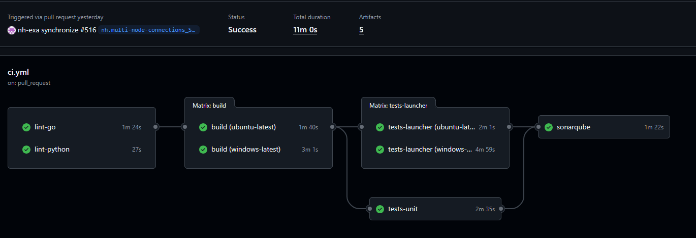
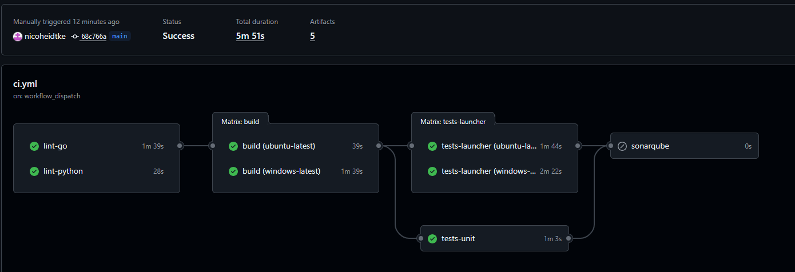

# setup-go-faster

Set up Go in GitHub Actions, with more control over how your module and build caches get reused and refreshed.

This is still a personal experiment. I started it because I got annoyed by how inefficient the standard `actions/setup-go` action felt and wanted to see if I could do better.

Feel free to use it and tell me how it goes. Bug reports, ideas, and general feedback are welcome in [issues](https://github.com/nicoheidtke/setup-go-faster/issues). I haven't tested every target platform and workflow scenario yet; the [current validation status](docs/DEVELOPMENT.md#support-and-validation-status) explains what's covered and what still needs checking.

It reuses a matching Go installation if one is already there. Otherwise, it downloads an official release and verifies it before installing it. The action itself runs prebuilt Go executables, so there's nothing to compile and no npm packages to install in your workflow.

The cache behavior is the main difference. With `cache: restore-save`, a job can restore a build cache and still save a fresh snapshot when it's done. You don't have to wait for a dependency change to refresh it. Module caches are handled separately by default, and unchanged module contents aren't uploaded again.

It targets **Go 1.26+** on Linux, macOS and Windows, on both amd64 and arm64. **Caching is off by default.** Turn it on if you want it.

## Quick start

Use `v1` for compatible updates. For a fixed revision, pin the full action distribution SHA recorded in the [release notes](https://github.com/nicoheidtke/setup-go-faster/releases).

```yaml
permissions:
  contents: read
jobs:
  test:
    runs-on: ubuntu-24.04
    steps:
      - uses: actions/checkout@3d3c42e5aac5ba805825da76410c181273ba90b1 # v7.0.1
      - uses: nicoheidtke/setup-go-faster@v1
        with:
          go-version-file: go.mod
          cache: restore-save
      - run: go test ./...
```

You can read the version from `go.mod` or `go.work`, or set it directly with something like `go-version: '1.26.x'` or an exact patch. A minor selector reuses an installed matching patch if it can. Set `check-latest: true` if you want the latest available patch instead.

Use `cache: restore` if you only want to read caches without uploading anything at the end. For matrix jobs, put the dimensions that differ between jobs in `cache-scope` so their caches stay separate. If you want to save build caches less often while still saving changed modules, there's [`cache-build-save`](docs/USAGE.md#choosing-a-save-policy) for that.

The default distribution bundles everything the action needs. There's also a lightweight option that downloads just the executable for the runner's platform and verifies it against the pinned metadata. The [usage guide](docs/USAGE.md) covers the inputs and examples, including [how the action is distributed](docs/USAGE.md#action-acquisition).

## Compared with actions/setup-go

GitHub's official action supports more Go versions and version formats. This one focuses on fresh caches, keeping job caches separate, and letting you decide what gets restored and saved.

That comes with tradeoffs. Fresh snapshots mean more uploads, and separate job caches can use more storage. I haven't established a controlled end-to-end speedup yet, so whether this saves time in your workflow still needs measuring. Include setup, cache restore, the actual work, and the final cache upload when you compare them.

The [comparison](docs/COMPARISON.md) goes through the differences. If you want to measure it yourself, the [benchmark guide](docs/BENCHMARKS.md) explains how.

### An anecdote from my day job

I work on [exasol/exasol-personal](https://github.com/exasol/exasol-personal) in my day job. To see whether this helped a real workflow, I [forked it](https://github.com/nicoheidtke/exasol-personal) and changed its CI to use `setup-go-faster` instead of `actions/setup-go`. With warm caches and the cache setup adjusted for the jobs, the build and test jobs finished noticeably sooner.

Here are the observed workflow and complete job durations, including setup and post steps, from two upstream runs and the fork run:

| Workflow / job | [Upstream run 43348902097](https://github.com/exasol/exasol-personal/actions/runs/43348902097) | [Upstream run 43442456182](https://github.com/exasol/exasol-personal/actions/runs/43442456182) | [Fork run 43666086120](https://github.com/nicoheidtke/exasol-personal/actions/runs/43666086120) |
| --- | --- | --- | --- |
| **Workflow elapsed** | **10m 18s** | **11m 00s** | **5m 51s** |
| Build (Ubuntu) | 1m 44s | 1m 40s | 39s |
| Build (Windows) | 2m 35s | 3m 01s | 1m 39s |
| Unit tests | 2m 41s | 2m 35s | 1m 03s |
| Launcher tests (Ubuntu) | 2m 09s | 2m 01s | 1m 44s |
| Launcher tests (Windows) | 5m 08s | 4m 59s | 2m 22s |
| Go lint | 52s | 1m 24s | 1m 39s |
| Python lint | 29s | 27s | 28s |
| SonarQube | 1m 29s | 1m 22s | Skipped |

Here are the workflow graphs for the upstream PR run and the warm-cache fork run:

**Upstream with `actions/setup-go` — 11m 00s** ([run](https://github.com/exasol/exasol-personal/actions/runs/43442456182)):



**Fork with `setup-go-faster` — 5m 51s** ([run](https://github.com/nicoheidtke/exasol-personal/actions/runs/43666086120)):



The upstream runs used `actions/setup-go` v6.5.0; the fork used `setup-go-faster` v1.0.0 with separate module/build caches, zstd compression, and matrix cache scopes. Its build and unit-test logs confirm that both Go cache snapshots were restored. I also changed the surrounding cache and warmup steps; launcher tests had Go caching disabled in the fork.

This is anecdotal evidence, and the comparison isn't entirely fair: these were different revisions and triggers (upstream push/PR versus a manual fork run), SonarQube was skipped in the fork, and runner load and cache histories weren't controlled. Go lint was slower in the fork, too. The workflow totals therefore don't establish a speedup attributable to this action alone. Still, seeing the Ubuntu build drop to 39 seconds and unit tests to just over a minute is why I'm pursuing this: keeping useful build caches warm can make a very visible difference in everyday CI. A controlled comparison still needs the [benchmark methodology](docs/BENCHMARKS.md).

## More details

- [Usage and input reference](docs/USAGE.md)
- [Troubleshooting](docs/TROUBLESHOOTING.md)
- [Architecture](docs/ARCHITECTURE.md) and [security model](docs/SECURITY_MODEL.md)
- [Contributing](CONTRIBUTING.md), [development](docs/DEVELOPMENT.md), and [releases](docs/RELEASES.md)
- [Security policy](SECURITY.md), [roadmap](ROADMAP.md), and [MIT license](LICENSE)
